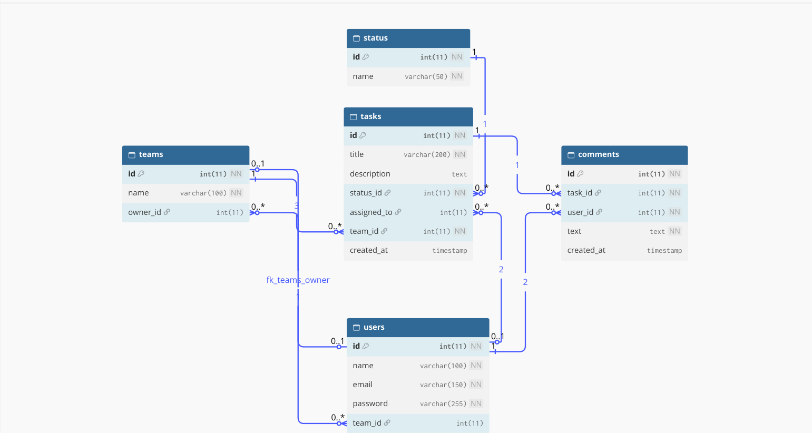
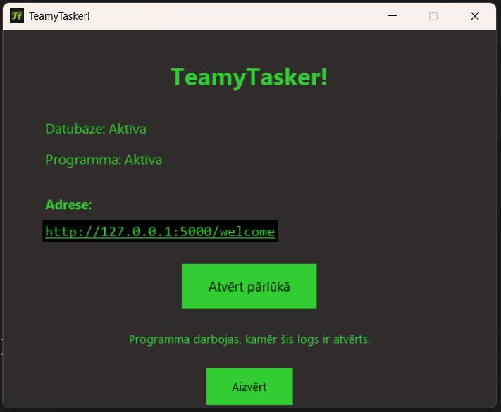
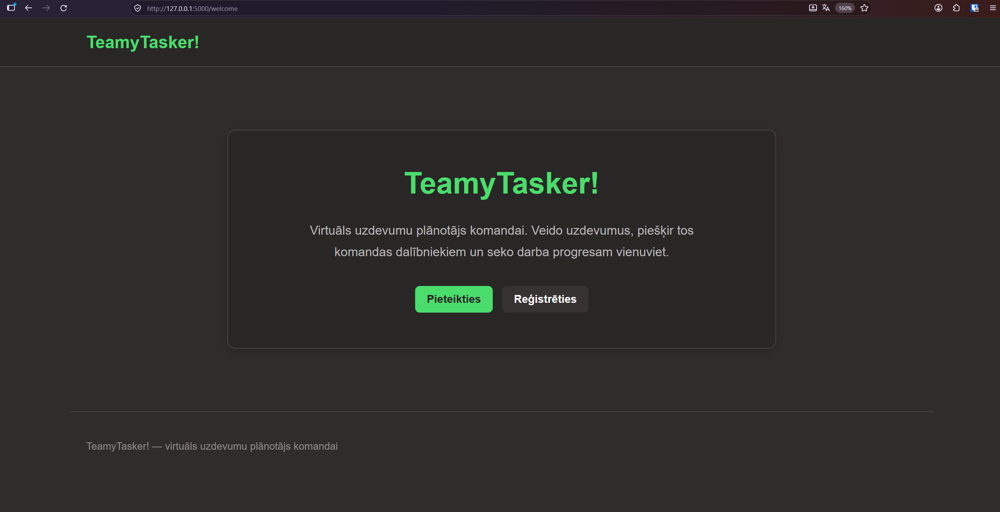
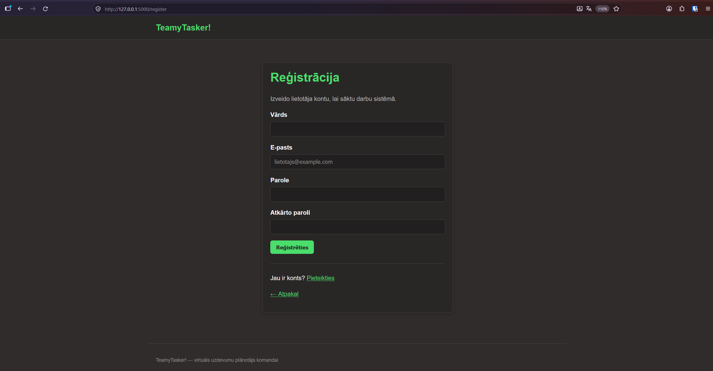
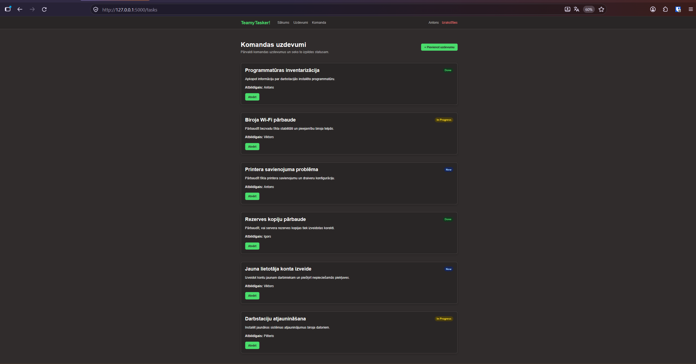
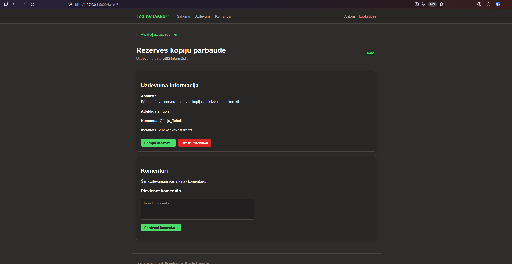
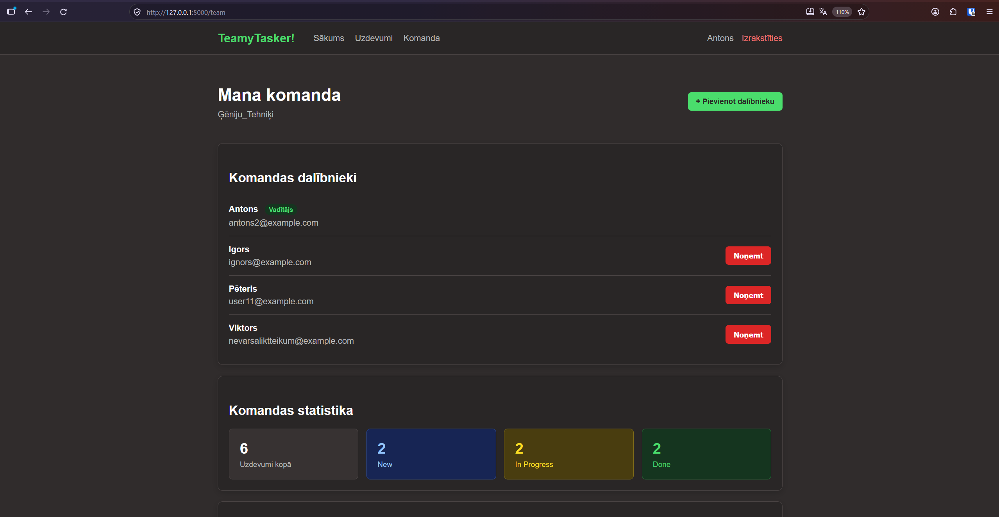

# TeamyTasker!

---

# Saturs

1. Darba apraksts
2. Prasības
3. Risinājuma projektējums
4. Programmas realizācija
5. Testēšana
6. Programmas palaišana un lietošana
7. Secinājumi
8. Izmantotie avoti
9. Pielikumi

---

# Darba apraksts

---

## Projekta apraksts

**TeamyTasker!** ir tīmekļa lietotne komandas darba un uzdevumu organizēšanai.

Sistēma nodrošina vienotu vidi, kur komandas dalībnieki var veidot uzdevumus, piešķirt tos konkrētiem lietotājiem, mainīt izpildes statusu un izmantot komentārus saziņai par konkrētu uzdevumu.

---

## Risināmā problēma

Komandas darbā nepieciešama vienota vieta, kur redzami aktuālie uzdevumi, to izpildes statuss un atbildīgie lietotāji.

TeamyTasker apkopo šo informāciju vienā sistēmā un nodala dažādu komandu datus.

---

## Darba mērķis

Izveidot funkcionējošu un pārskatāmu komandas uzdevumu pārvaldības sistēmu ar lietotāju autentifikāciju, komandu pārvaldību, uzdevumu CRUD funkcionalitāti, komentāriem un datu glabāšanu relāciju datubāzē.

---

## Galvenie uzdevumi

- realizēt lietotāju reģistrāciju un autentifikāciju;
- izveidot komandu pārvaldību;
- nodalīt komandas vadītāja un dalībnieka iespējas;
- realizēt uzdevumu izveidi, apskati, rediģēšanu un dzēšanu;
- nodrošināt uzdevumu piešķiršanu komandas dalībniekiem;
- realizēt uzdevumu statusus;
- izveidot komentāru sistēmu;
- nodrošināt datu nodalīšanu starp komandām;
- izveidot komandas uzdevumu statistiku;
- saglabāt datus MariaDB datubāzē;
- nodrošināt iespēju palaist gatavo programmu Windows datorā.

---

## Paredzētie lietotāji

Sistēma paredzēta nelielām komandām, kurām nepieciešams vienkāršs rīks uzdevumu organizēšanai.

Sistēmā tiek nodalīts:

- komandas vadītājs;
- komandas dalībnieks.

Komandas vadītājam papildus ir pieejama dalībnieku pārvaldība.

---

# Prasības

---

## Funkcionālās prasības

| ID | Prasība |
|---|---|
| F1 | Lietotājs var reģistrēties sistēmā |
| F2 | Lietotājs var pieteikties un izrakstīties |
| F3 | Lietotājs var izveidot komandu |
| F4 | Komandas vadītājs var pievienot un noņemt dalībniekus |
| F5 | Lietotājs var izveidot uzdevumu |
| F6 | Lietotājs var apskatīt uzdevumus |
| F7 | Lietotājs var rediģēt uzdevumu |
| F8 | Lietotājs var dzēst uzdevumu |
| F9 | Uzdevumam var mainīt statusu |
| F10 | Uzdevumu var piešķirt komandas dalībniekam |
| F11 | Lietotājs var pievienot komentārus uzdevumam |
| F12 | Komandas skatā tiek attēlota uzdevumu statistika |
| F13 | Lietotājs nevar piekļūt citas komandas uzdevumiem |

---

## Nefunkcionālās prasības

- lietotāja saskarnei jābūt vienkāršai un pārskatāmai;
- datiem jāglabājas relāciju datubāzē;
- paroles nedrīkst glabāt atklātā tekstā;
- sensitīvus konfigurācijas datus nedrīkst glabāt publiski pieejamā pirmkodā;
- SQL vaicājumos jāizmanto parametrizētas vērtības;
- aizsargātās sistēmas sadaļas nedrīkst būt pieejamas bez autentifikācijas;
- dažādu komandu dati nedrīkst būt savstarpēji pieejami;
- programmai jābūt viegli palaižamai uz Windows datora, bez papildus konfigurācijas.

---

# Risinājuma projektējums

---

## Izmantotās tehnoloģijas

| Tehnoloģija | Pielietojums |
|---|---|
| Python | Programmas servera puses loģika |
| Flask | Tīmekļa aplikācijas maršruti un pieprasījumu apstrāde |
| MariaDB | Relāciju datubāze |
| PyMySQL | Python savienojums ar MariaDB |
| HTML / Jinja2 | Dinamiskās tīmekļa lapas |
| CSS | Lietotāja saskarnes noformējums |
| Werkzeug | Paroļu hash izveide un pārbaude |
| python-dotenv | Vides konfigurācijas ielāde |
| PyInstaller | Windows izpildāmās programmas izveide |
| Git / GitHub | Versiju kontrole |

---

## Tehnoloģiju izvēles pamatojums

**Python un Flask** tika izvēlēti, jo tie ļauj izveidot tīmekļa lietotni ar salīdzinoši vienkāršu projekta struktūru un skaidri nodalītiem maršrutiem.

**MariaDB** izmantota kā relāciju datubāze, jo projekta dati sastāv no vairākām savstarpēji saistītām tabulām: lietotājiem, komandām, uzdevumiem, statusiem un komentāriem.

**PyMySQL** nodrošina savienojumu starp Python aplikāciju un MariaDB.

**HTML, Jinja2 un CSS** izmantoti lietotāja saskarnes veidošanai.

**PyInstaller** izmantots, lai programmu varētu palaist Windows datorā, ar vienkāršu `.exe` bez atsevišķas Python instalācijas.

---

## Programmas struktūra

Galvenā projekta struktūra:

```text
TeamyTasker/
│
├── assets/
│   └── TeamyTasker.ico
│
├── database/
│   ├── create_database.sql
│   └── db.py
│
├── docs/
│   ├── documentation.md
│   ├── ER_Diagram.pdf
│   └── images/
│        
├── runtime/ (release versijā)
│   └── mariadb/
│
├── static/
│   └── css/
│       └── style.css
│
├── templates/
│   ├── add_task.html
│   ├── add_team_member.html
│   ├── base.html
│   ├── create_team.html
│   ├── edit_task.html
│   ├── index.html
│   ├── login.html
│   ├── register.html
│   ├── task_details.html
│   ├── tasks.html
│   ├── team.html
│   └── welcome.html
│
├── app.py
├── launcher.py
├── README.md
├── requirements.txt
├── .env.example
└── .gitignore
```

Galveno mapju un failu uzdevumi:

- `app.py` – satur Flask aplikācijas galveno funkcionalitāti: autentifikāciju, komandu pārvaldību, uzdevumus, komentārus un statistiku;
- `launcher.py` – sagatavo portatīvo MariaDB vidi, palaiž datubāzes un Flask serveri un ļauj atvērt programmu pārlūkprogrammā;
- `database/` – satur datubāzes savienojuma kodu un SQL failus;
- `templates/` – satur Jinja2 HTML veidnes;
- `static/` – satur lietotāja saskarnes CSS noformējumu;
- `runtime/mariadb/` – satur portatīvās MariaDB darbībai nepieciešamos failus;
- `assets/` – satur programmas vizuālos resursus, piemēram, TeamyTasker ikonu;
- `docs/` – satur tehnisko dokumentāciju, ER diagrammu un programmas ekrānuzņēmumus;
- `requirements.txt` – satur Python bibliotēkas, kas nepieciešamas projekta darbināšanai no pirmkoda;
- `.env.example` – konfigurācijas faila piemērs bez īstām piekļuves parolēm.

> `.env` tiek izmantots lokālajā izstrādes vidē un netiek publicēts kopā ar projekta pirmkodu.

---

## Sistēmas darbības princips

TeamyTasker ir lokāli darbināma tīmekļa aplikācija. Lietotāja saskarne tiek atvērta tīmekļa pārlūkprogrammā, bet programmas loģiku izpilda Flask serveris.

**Shēma:**

```text
TeamyTasker.exe
       │
       ▼
   launcher.py
       │
       ├──────────────► Portatīvā MariaDB
       │                   ports 3307
       │
       └──────────────► Flask aplikācija
                           ports 5000
                                │
                                ▼
                         Tīmekļa pārlūks
                                │
                                ▼
                          TeamyTasker!
```

`TeamyTasker.exe` palaiž launcher. Launcher pārbauda nepieciešamos programmas failus un sagatavo portatīvo MariaDB instanci. MariaDB glabā programmas datus, savukārt Flask nodrošina programmas loģiku un tīmekļa lapas.

Flask aplikācija ar MariaDB sazinās, izmantojot PyMySQL.

Lietotājs programmu izmanto pārlūkprogrammā, atverot lokālo adresi:

```text
http://127.0.0.1:5000/welcome
```

Gatavā portatīvā versija izmanto:

```text
Flask:   127.0.0.1:5000
MariaDB: 127.0.0.1:3307
```

Portatīvās datubāzes mainīgie dati un lokālā konfigurācija tiek glabāti lietotāja lokālajā `TeamTaskPlanner` datu mapē (`LOCALAPPDATA`).

---

## Datu modelis

Sistēmā izmantotas piecas galvenās tabulas:

- `Users` – lietotāju konti;
- `Teams` – komandas;
- `Tasks` – komandu uzdevumi;
- `Status` – uzdevumu statusi;
- `Comments` – uzdevumu komentāri.

Galvenās datubāzes attiecības:

```text
Users.team_id       → Teams.id
Teams.owner_id      → Users.id

Tasks.status_id     → Status.id
Tasks.assigned_to   → Users.id
Tasks.team_id       → Teams.id

Comments.task_id    → Tasks.id
Comments.user_id    → Users.id
```

### ER diagramma

---

**1. att. ER diagramma**



---

---

## Lietotāja saskarnes projektējums

Sākotnējā projektēšanas posmā tika sagatavotas galveno sistēmas skatu skices:

- uzdevumu saraksts;
- uzdevuma detalizētais skats;
- komandas pārvaldības skats.

Realizācijas laikā sākotnējais projektējums tika papildināts ar autentifikācijas, komandas vadītāja, statistikas un kopējās navigācijas skatiem.

---

# Programmas realizācija

---

## Autentifikācija

Lietotājs reģistrējas ar vārdu, e-pasta adresi un paroli.

Parole pirms saglabāšanas datubāzē tiek pārveidota par hash. Pieteikšanās laikā ievadītā parole tiek pārbaudīta pret saglabāto hash.

Pēc veiksmīgas pieteikšanās lietotāja informācija tiek saglabāta Flask sesijā.

Aizsargātajiem sistēmas maršrutiem nepieciešama aktīva lietotāja sesija.

---

## Komandu pārvaldība

Lietotājs, kurš vēl nav komandā, var izveidot jaunu komandu.

Komandas izveidotājs kļūst par tās vadītāju.

Vadītājs var:

- pievienot sistēmā reģistrētus lietotājus;
- noņemt komandas dalībniekus.

Parastam komandas dalībniekam šīs pārvaldības funkcijas nav pieejamas.

---

## Uzdevumu pārvaldība

Uzdevumu modulī realizētas CRUD operācijas:

- Create – uzdevuma izveide;
- Read – uzdevuma apskate;
- Update – uzdevuma rediģēšana;
- Delete – uzdevuma dzēšana.

Uzdevumam var norādīt:

- nosaukumu;
- aprakstu;
- statusu;
- atbildīgo lietotāju.

Uzdevums automātiski tiek piesaistīts pašreizējā lietotāja komandai.

---

## Komandu datu izolācija

Uzdevumu darbībās tiek pārbaudīts lietotāja `team_id`.

Lietotājs var apskatīt, rediģēt, dzēst un komentēt tikai savas komandas uzdevumus.

Pārbaude tiek veikta servera pusē.

---

## Komentāri

Komentārs tiek piesaistīts:

- konkrētam uzdevumam;
- komentāra autoram.

Autora ID tiek iegūts no aktīvās lietotāja sesijas.

---

## Statistika

Komandas skatā tiek iegūta aktuāla statistika:

- uzdevumu kopskaits;
- `New`;
- `In Progress`;
- `Done`.

Statistika tiek aprēķināta no MariaDB datiem.

---

## Launcher un portatīvā versija

`Launcher.py`, kam tas paredzēts?

1. pārbauda nepieciešamo failu pieejamību;
2. pirmajā palaišanas reizē inicializē portatīvo MariaDB;
3. palaiž MariaDB uz atsevišķa lokālā porta;
4. izveido TeamyTasker datubāzes struktūru;
5. konfigurē Flask savienojumu;
6. palaiž Flask serveri;
7. parāda datubāzes un programmas statusu;
8. ļauj atvērt aplikāciju pārlūkprogrammā;
9. aizverot launcher, aptur lokālo datubāzes procesu.

*Programmas mainīgie lokālie dati tiek glabāti lietotāja `%LOCALAPPDATA%` direktorijā.*

---

### Launcher skats

---

**2. att. Launcher logs**



---

## Gatavās programmas saskarne

### Publiskā sākumlapa

---

**3. att. Sākumlapa**



---

### Lietotāja reģistrācija

---

**4. att. Reģistrācijas lapa**



---

### Uzdevumu saraksts

---

**5. att. Uzdevumu saraksts**



---

### Uzdevuma detalizētais skats

---

**6. att. Uzdevuma pārskats**



---

### Komandas skats

---

**7. att. Komandas dalībnieku saraksts**



---

---

# Testēšana

---

## Testēšanas pieeja

Programmai veikta manuāla funkcionālā testēšana.

Testētas:

- lietotāju darbības;
- komandu pārvaldība;
- uzdevumu CRUD;
- komentāri;
- validācija;
- lietotāju tiesības;
- datu nodalīšana;
- programmas palaišana citā Windows datorā.

---

## Funkcionālie testi

| ID | Tests | Rezultāts |
|---|---|---|
| T01 | Publiskā sākumlapa | PASS |
| T02 | Lietotāja reģistrācija | PASS |
| T03 | Pieteikšanās | PASS |
| T04 | Lietotājs bez komandas | PASS |
| T05 | Komandas izveide | PASS |
| T06 | Dalībnieka pievienošana | PASS |
| T07 | Uzdevuma izveide | PASS |
| T08 | Uzdevuma detaļu apskate | PASS |
| T09 | Uzdevuma rediģēšana | PASS |
| T10 | Statistikas atjaunošana | PASS |
| T11 | Komentāra pievienošana | PASS |
| T12 | Otra dalībnieka komentārs | PASS |
| T13 | Dalībnieka tiesību pārbaude | PASS |
| T14 | Svešas komandas uzdevuma apskate | PASS |
| T15 | Svešas komandas uzdevuma rediģēšana | PASS |
| T16 | Aizsargātas lapas bez autentifikācijas | PASS |
| T17 | Nepareiza parole | PASS |
| T18 | Neeksistējošs e-pasts | PASS |
| T19 | Atšķirīgas paroles reģistrācijā | PASS |
| T20 | Atkārtota e-pasta reģistrācija | PASS |
| T21 | Neeksistējoša dalībnieka pievienošana | PASS |
| T22 | Atkārtota dalībnieka pievienošana | PASS |
| T23 | Tukšs uzdevuma nosaukums | PASS |
| T24 | Tukšs komentārs | PASS |
| T25 | Uzdevuma dzēšana | PASS |
| T26 | Dalībnieka noņemšana | PASS |
| T27 | Izrakstīšanās | PASS |

---

## Portatīvās versijas tests

| Pārbaude | Rezultāts |
|---|---|
| EXE palaišana | PASS |
| Portatīvās MariaDB inicializācija | PASS |
| Datubāzes servera palaišana | PASS |
| Flask servera palaišana | PASS |
| Programmas atvēršana pārlūkā | PASS |
| Jauna lietotāja reģistrācija | PASS |
| Komandas izveide | PASS |

---

## Testēšanas laikā novērstās problēmas

- uzdevumu piesaiste konkrētiem testa ID tika aizvietota ar pašreizējās komandas datiem;
- pievienota servera puses komandas pārbaude;
- pievienotas komandas vadītāja tiesības;
- noņemot dalībnieku, tiek noņemta lietotāja piesaiste komandas uzdevumiem;
- uzdevuma dzēšanā papildināta kļūdu apstrāde;
- EXE versijai papildināta ārējo failu pārbaude;
- launcher kļūdas tiek saglabātas žurnālā un parādītas lietotājam.

---

# Programmas palaišana un lietošana

---

## Gatavās Windows versijas palaišana

1. Palaist `TeamyTasker.exe` failu. Launcher automātiski sagatavo nepieciešamo lokālo vidi.

2. Sagaidīt inicializācijas pabeigšanu:

```text
Datubāze: Aktīva
Programma: Aktīva
```

3. Nospiest pogu `Atvērt pārlūkā`.

*Programma tiek atvērta noklusējuma tīmekļa pārlūkprogrammā!*

**Svarīgi!**
*Launcher logam programmas izmantošanas laikā jāpaliek atvērtam. Citādi programas darbība tiks pārtraukta!*

---

## Palaišana no pirmkoda

1. Izveidot virtuālo vidi:

```cmd
python -m venv venv
```

2. Aktivizēt `.venv`:

```cmd
venv\Scripts\activate
```

3. Instalēt nepieciešamās pakotnes:

```cmd
pip install -r requirements.txt
```

4. Konfigurēt `.env` failu pēc `.env.example` parauga.

5. Palaist programmu:

```cmd
python app.py
```

**Svarīgs noteikums**

*Pirms norādītajiem palaišanas soļiem uz esošā datora jābūt instalētam: Python un MariaDB*

---

## Lietošana

*Darba secība:*

1. Reģistrē lietotāju;
2. Piesakās sistēmā;
3. Izveido komandu vai tiek pievienots esošajai komandai;
4. Izveido uzdevumu;
5. Norāda statusu un atbildīgo;
6. Nepieciešamības gadījumā rediģē uzdevumu;
7. Pievieno komentārus;
8. Komandas skatā pārbauda statistiku;
9. Pēc darba izraksties.

---

# Secinājumi

---

Darba rezultātā izveidota funkcionējoša komandas uzdevumu pārvaldības sistēma **TeamyTasker**.

Realizēta lietotāju autentifikācija, komandu pārvaldība, uzdevumu CRUD funkcionalitāte, statusi, komentāri, statistika un datu nodalīšana starp komandām.

Sistēmas datu glabāšanai izmantota MariaDB relāciju datubāze.

Papildus tīmekļa aplikācijai izveidots launcher un portatīvā Windows versija.

Tādējādi sākotnēji izvirzītais mērķis izveidot izmantojamu komandas uzdevumu plānotāju ir sasniegts.

Turpmāk sistēmu iespējams papildināt ar:

- uzdevumu termiņiem;
- prioritātēm;
- meklēšanu;
- filtrēšanu;
- paziņojumiem;
- paroles atjaunošanu;
- papildu lietotāju lomām;
- automātiskajiem testiem;
- Baltā vai tumšā fona izvēli.

---

# Izmantotie avoti

---

1. Flask dokumentācija  
   https://flask.palletsprojects.com/

2. Python dokumentācija  
   https://docs.python.org/

3. MariaDB dokumentācija  
   https://mariadb.com/docs/

4. PyMySQL dokumentācija  
   https://pymysql.readthedocs.io/

5. Werkzeug dokumentācija  
   https://werkzeug.palletsprojects.com/

6. PyInstaller dokumentācija  
   https://pyinstaller.org/

---

# Pielikumi

---

- docs/ER_Diagram - ER_Diagramma
- docs/images/ - attēli

---

# Autors

---

Deniss Cvetkovs  

Github repo: https://github.com/Gosha2251/TeamyTasker
